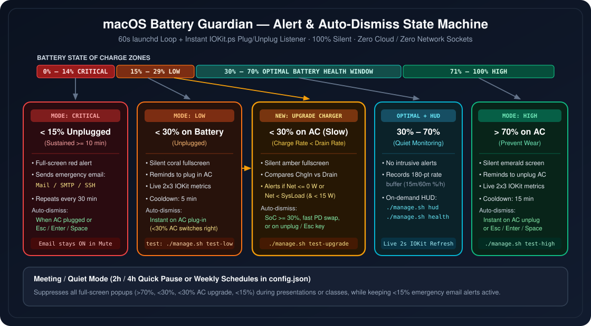
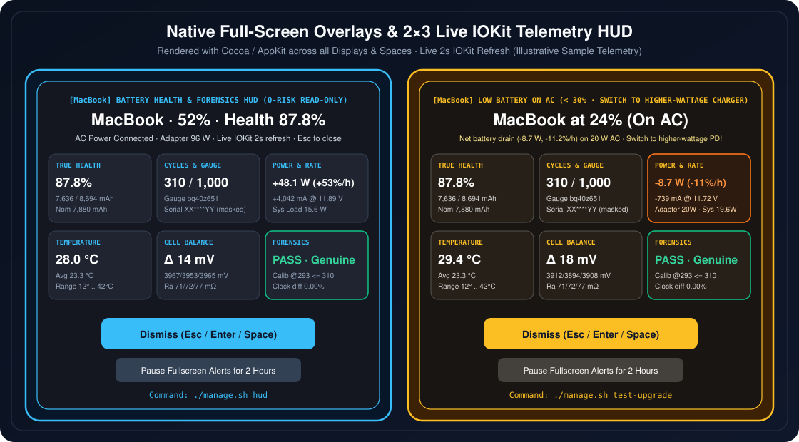
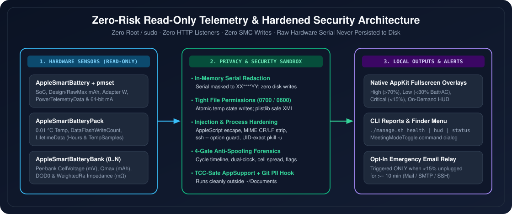

# macOS Battery Guardian

A lightweight, silent, native macOS battery health monitor that displays full-screen overlays when your battery exceeds **70%** on AC power, drops below **30%** on battery, or stays below **30%** even while connected to AC power (prompting you to switch to a higher-wattage charger), **auto-dismisses automatically**, and sends an emergency email if your Mac remains unplugged below **15%** for an extended period.



## Visual Feature Overview

### 1. Native Full-Screen Alerts & 2×3 Live Telemetry HUD


### 2. Zero-Risk Read-Only Telemetry & Privacy Architecture


## Features

- **100% Silent Full-Screen Alerts**: Built natively with Cocoa/AppKit (`NSWindow.Level.screenSaver`) across all connected displays and full-screen Spaces without making any sound—safe for meetings, libraries, and lectures. Includes a **live 2×3 hardware telemetry grid** on every alert card.
- **Zero-Risk Hardware Telemetry & Anti-Spoofing HUD (`./manage.sh health` / `./manage.sh hud`)**:
  - Reads `IOKit` / `AppleSmartBattery` registers directly (zero network sockets, zero HTTP ports, zero third-party packages, zero `sudo`/root, zero hardware writes).
  - Displays true battery health (`AppleRawMaxCapacity / DesignCapacity`), pack temperature, live watts & charge/discharge rate (`%/h`, instantaneous + 15m/60m sliding windows), multi-bank cell voltage/Qmax/impedance balance, and a **4-Gate TI Gas-Gauge Anti-Spoofing Audit** (`Calibration Timeline`, `Dual-Clock Integrity`, `Cell Balance`, `DataFlash/PF Flags`).
  - Hardware serial numbers are **never** written to disk (`state.json` or logs) and are middle-masked (`XX****YY`) on screen.
- **Hardened Local Security**: Enforces `0700` runtime directory and `0600` permissions on `config.json`, `state.json`, and log files; generates plists via `plistlib`; defends against SSH option injection, MIME header injection, and AppleScript string escaping; scopes process cleanup strictly to the current UID.
- **Instant AC Plug / Unplug & Recovery Auto-Dismiss**: Uses macOS `IOKit.ps` (`IOPSNotificationCreateRunLoopSource` + `0.5s` fallback check) plus live capacity monitoring so full-screen alerts dismiss automatically when you unplug AC (during `>70%` alerts), plug in AC (during `<30%` battery alerts), or recover `>=30%` / unplug (during `<30%` AC charger-upgrade alerts). You can also dismiss manually with `Esc`, `Enter`, `Space`, or the on-screen button.
- **Smart Thresholds (Configurable)**:
  - **High Battery (`> 70%` on AC)**: Reminds you to unplug your charger to slow battery wear.
  - **Low Battery (`< 30%` on battery)**: Reminds you to plug in your charger.
  - **Low Battery Even on AC (`< 30%` on AC when Charging < Drain)**: Compares live charger input (`SystemPowerIn`) and net battery rate (`BatteryPower`, `%/h`) against system consumption (`SystemLoad` & recent unplugged drain `%/h`). Whenever `< 30%` on AC and charging cannot keep up (`Net <= 0 W`, `15m <= 0%/h`, or `Net < SystemLoad` while `< 15 W`), pops an amber prompt to switch to a higher-wattage USB-C PD charger (auto-closes on `>= 30%`, fast PD swap, or unplug).
  - **Critical Low Battery (`< 15%` unplugged for >= 10 minutes)**: Triggers a critical red full-screen alert and dispatches an emergency email notification containing your device name, battery level, and status.
- **Meeting / Quiet Mode**: Pause full-screen popups for 2 or 4 hours via the on-screen button, CLI, double-clickable `MeetingModeToggle.command`, or recurring weekly schedules in `config.json`.
- **Multiple Email Backends**: Supports Apple **Mail.app**, direct **SMTP** (`SSL`/`STARTTLS`), or remote **SSH `sendmail`** relay.
- **TCC-Safe `launchd` Daemon**: Installs runtime files to `~/Library/Application Support/BatteryGuardian` so macOS background `launchd` jobs are never blocked by `~/Documents` privacy (TCC) restrictions.

## Requirements

- macOS (Apple Silicon or Intel)
- Xcode Command Line Tools (`swiftc`) and `python3` (installed via `xcode-select --install` if not already present)

## Quick Start

1. **Clone the repository and create your local config**:
   ```zsh
   git clone https://github.com/zengyaolv/macos-battery-guardian.git
   cd macos-battery-guardian
   cp config.example.json config.json
   ```
2. **Edit `config.json`** to set your `device_name`, thresholds, and optional email notification settings.
3. **Compile, install, and start the background `launchd` agent**:
   ```zsh
   chmod +x manage.sh battery_monitor.py MeetingModeToggle.command
   ./manage.sh install
   ```
4. **Check status, inspect hardware health, or open the on-screen HUD**:
   ```zsh
   ./manage.sh status
   ./manage.sh health
   ./manage.sh hud
   ./manage.sh test-high
   ./manage.sh test-low
   ./manage.sh test-upgrade
   ./manage.sh test-critical
   ```

## CLI Commands (`./manage.sh`)

| Command | Description |
| --- | --- |
| `./manage.sh install` | Compile `BatteryFullscreenAlert.app`, sync files to `~/Library/Application Support/BatteryGuardian` (`0700`/`0600`), generate the `launchd` plist safely via `plistlib`, and start the daemon (checks every 60s). |
| `./manage.sh status` | Show current battery status, concise IOKit health/forensics summary, alert mode, active thresholds, and `launchd` status. |
| `./manage.sh health` | Print the full read-only hardware telemetry, rate (`%/h`), cell balance, and 4-gate gas-gauge anti-spoofing audit to the terminal (`--screen` also opens the HUD). |
| `./manage.sh hud` | Pop up the native live on-screen HUD overlay across all connected displays (0-risk read-only IOKit, refreshes every 2s; close with `Esc`/`Enter`/`Space`). |
| `./manage.sh pause [minutes]` | Pause fullscreen popups for `N` minutes (default `120`; `<15%` critical emails remain active). |
| `./manage.sh unmute` | Resume silent fullscreen alerts immediately. |
| `./manage.sh set-email <addr>` | Safely validate and update `email.to_email` in both local and runtime `config.json` (`0600`). |
| `./manage.sh test-high` | Preview the `>70%` silent fullscreen alert (auto-closes if you plug/unplug AC or press `Esc`). |
| `./manage.sh test-low` | Preview the `<30%` silent fullscreen alert. |
| `./manage.sh test-upgrade` | Preview the `<30%` on-AC higher-wattage charger prompt with live telemetry. |
| `./manage.sh test-critical` | Preview the `<15%` critical fullscreen alert. |
| `./manage.sh test-email` | Send a test email using the configured backend. |
| `./manage.sh uninstall` | Unload and remove the background `launchd` agent. |

You can also double-click `MeetingModeToggle.command` in Finder to open the HUD or toggle Meeting Mode via a native macOS dialog.

## Configuration (`config.example.json`)

| Key | Default | Description |
| --- | --- | --- |
| `device_name` | `"MacBook"` | Label displayed on alerts and email subjects/bodies. |
| `high_threshold_percent` | `70` | Trigger high-battery alert above this percentage. |
| `high_only_on_ac` | `true` | Only show high-battery alert while connected to AC power. |
| `high_snooze_minutes` | `15` | Cooldown before re-alerting if still above high threshold. |
| `low_threshold_percent` | `30` | Trigger low-battery alert below this percentage. |
| `low_only_on_battery` | `true` | Only show `"low"` plug-in alert while running on battery. |
| `low_snooze_minutes` | `5` | Cooldown before re-alerting if still below low threshold. |
| `low_on_ac_upgrade_charger` | `true` | Detect charging rate vs drain rate below `low_threshold_percent` on AC and prompt for a higher-wattage charger when insufficient. |
| `low_on_ac_policy` | `"smart"` | `"smart"` (triggers on net drain `<= 0 W` or when net charge `< SystemLoad` while `< 15 W`), `"deficit_only"` (strict `<= 0 W` / `<= 0%/h` net drain), or `"always"` (any charger `< 30%`). |
| `low_on_ac_snooze_minutes` | `5` | Cooldown before repeating the `<30%` higher-wattage charger prompt while on AC. |
| `low_on_ac_min_battery_watts` | `null` | Optional: suppress the `<30%` AC upgrade prompt if net battery charging power meets or exceeds this wattage (`W`). |
| `low_on_ac_min_adapter_watts` | `null` | Optional: suppress the `<30%` AC upgrade prompt if connected adapter rated wattage meets or exceeds this value (`W`). |
| `critical_threshold_percent` | `15` | Critical battery threshold for prolonged unplugged alerts. |
| `critical_unchanged_minutes` | `10` | Unplugged duration below critical threshold before emailing. |
| `critical_email_repeat_minutes` | `30` | Minimum interval between repeat critical emails. |
| `quiet_mode.schedules` | `[]` | Optional recurring weekly windows (`days_of_week` `1`-`7`, `start`, `end`, `action: "pause"`). |
| `email.enabled` | `false` | Set `true` to enable critical low-battery email notifications. |
| `email.method` | `"mail_app"` | `"mail_app"` (Apple Mail), `"smtp"`, or `"ssh_sendmail"`. |
| `email.to_email` | `"you@example.com"` | Recipient email address. |

## Uninstall

```zsh
./manage.sh uninstall
rm -rf "$HOME/Library/Application Support/BatteryGuardian"
```

## License

[MIT](LICENSE)
